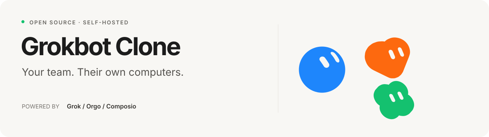

<p align="center">
  
</p>

<p align="center">
  A self-hosted Grok Bot clone specialized for <strong>ecommerce design services</strong>:<br>
  catalog merchandising, product presentation, and store/catalog design help<br>
  against a real merchant product catalog (CSV or JSON feed → SQLite).
</p>

<p align="center">
  <a href="#quick-start">Quick start</a> ·
  <a href="#ecommerce-design-services">Design services</a> ·
  <a href="docs/ECOMMERCE.md">Catalog docs</a> ·
  <a href="docs/ARCHITECTURE.md">Architecture</a>
</p>

---

Grokbot recreates the Grok Bot chat/agent experience with a runtime you can run and modify. This fork positions it for **studios/agencies** helping merchants design stores and product presentation — not as a generic consumer checkout chatbot.

## Ecommerce design services

- Primary Bot **Studio** with a design-studio system prompt  
- `shop_*` tools against **merchant catalog data** in SQLite  
- Product / selection-bag / staged-sheet cards in chat  
- Catalog side panel for search + lookbook staging  
- Load real products via `CATALOG_FEED_URL` or `CATALOG_CSV_PATH` (demo seed only when empty)

| Need | Env |
| --- | --- |
| Chat + catalog tools | `XAI_API_KEY`, `SESSION_SECRET`, `DEV_LOGIN=1` |
| Merchant catalog | `CATALOG_FEED_URL` and/or `CATALOG_CSV_PATH` (+ `STORE_NAME`) |
| Google sign-in / apps | `COMPOSIO_API_KEY` (optional) |
| Computer use | `ORGO_API_KEY` + `ORGO_WORKSPACE_ID` (optional) |
| Classic teammate prompt | `ECOMMERCE_MODE=0` |

See [docs/ECOMMERCE.md](docs/ECOMMERCE.md).

## What you can do

- **Design with the catalog.** Review SKUs, improve titles/blurbs, stage lookbooks, spot data gaps.  
- **Give every Bot a role.** Instructions, appearance, skills, memories.  
- **Optional computer & apps.** Orgo desktops and Composio connectors when configured.  
- **Keep context.** Durable memories and compacted conversations.  
- **Voice.** Realtime calls when xAI voice is available.

## Quick start

### 1. Get the project

Install **Node.js 22.22 or newer**, then:

```bash
git clone https://github.com/6LAILAI/grokbot-clone.git
cd grokbot-clone
npm ci
cp .env.example .env
```

### 2. Configure

Minimum:

| Variable | Purpose |
| --- | --- |
| `XAI_API_KEY` | Grok text (and voice) API access |
| `SESSION_SECRET` | Session signing (`openssl rand -hex 32`) |
| `DEV_LOGIN` | `1` for local email sign-in |
| `STORE_NAME` | Merchant/engagement label |
| `CATALOG_CSV_PATH` or `CATALOG_FEED_URL` | Real product catalog |

```bash
npm run catalog:import -- ./data/catalog.sample.csv
```

### 3. Start

```bash
npm run dev -w server
npm run dev -w web
```

Open **[localhost:5173](http://localhost:5173)**. Sign in with the email form.

## License

See `LICENSE` and `THIRD_PARTY_NOTICES.md`. Not affiliated with xAI.
